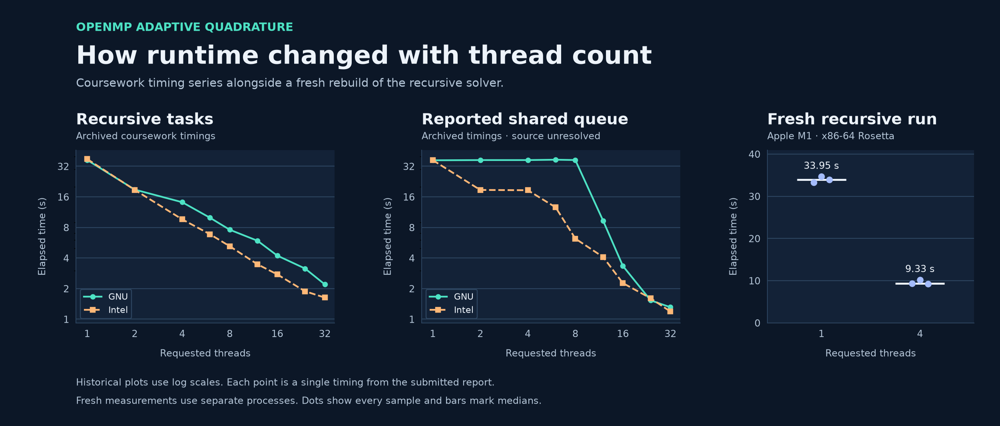

# OpenMP Adaptive Quadrature

A case study from my 2024–25 MSc Threaded Programming coursework at the
University of Edinburgh. I used OpenMP tasks to parallelize a recursive
adaptive Simpson integrator and investigated queue-based work distribution.
I revisited the saved implementation to check what the original timing
results could establish about the code.



## What the code review found

- **Recursive tasks.** Each interval evaluates a coarse and a refined
  estimate. Subdivision exposes two independent pieces of work. The saved
  recursive implementation creates OpenMP tasks for larger intervals and
  waits for both children before summing their results.
- **Queue prototype.** The saved queue implementation has a dequeue and
  work-stealing structure, but its work loop has no interval computation
  or accumulation. A fresh run returned zero. The historical table
  identifies its second variant as a shared-queue version. The surviving
  source cannot reproduce that series.

## What the timings show

The original coursework report recorded nine thread counts for each combination
of solver variant and compiler. For the recursive solver, GNU went from
36.89 s at one requested thread to 2.20 s at 32. Intel went from 37.68 s
to 1.63 s. Each point is a single reported time. Cirrus was the assigned
platform. The exact historical executable, host, actual team sizes and
affinity are unverified.

A fresh local rebuild of the saved recursive solver under x86-64 Rosetta
repeated the same input three times each at one and four requested
threads. Median runtime fell from **33.95 s to 9.33 s**, a **3.64× ratio**.
Every run printed the same estimate, **−0.1699471**. The
independent real-arithmetic reference is **−0.16982011826730794**.
The difference from the rounded console result is about **1.27 × 10⁻⁴**.
The saved subdivision rule reuses a local tolerance in each child
interval, so the nominal `1e-6` does not provide a bound on total error.

The [evidence notes](docs/evidence.md) explain the reference derivation,
the scope of each timing comparison and the missing link between the
historical queue timings and the saved source.

## Recreate the figure

Use Python 3.11 and the pinned plotting dependency.

```sh
python3 -m pip install -r requirements.txt
python3 scripts/plot_results.py
```

The figure is generated from the checked-in historical and fresh records.
The University starter and submission are retained in the private course archive.
